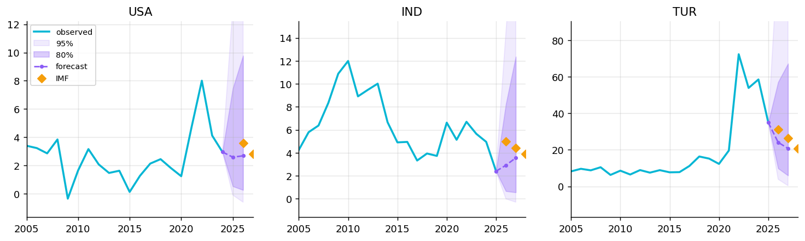

# RealGrowth

**Is pay keeping up with prices, and what will prices do next?** RealGrowth is
an end-to-end data science platform covering 218 countries. It ingests 21
macroeconomic series from the World Bank, IMF and Our World in Data APIs. It
forecasts national inflation 1-2 years ahead with calibrated uncertainty, and
it uses forensic reconstruction to detect invented values in its own source
data. All of this is served through a typed API and a React app with tools
people can use: an inflation outlook and a purchasing-power calculator.

| | |
|---|---|
| **Data** | 197,876 observations · 24 indicators · 1960-2025 · weekly refresh from public APIs, versioned snapshots with SHA-256 |
| **Forecasting** | Ensemble of pooled AR + global LightGBM. Held-out test (2010-2025): **10.9% / 17.3% lower error than the random walk** at 1 / 2 years, Diebold-Mariano p = 0.016 / 0.021 |
| **Uncertainty** | Mondrian split-conformal intervals: **79.2% coverage at nominal 80%**, 95.6% at 95% |
| **Data forensics** | Reverse-engineered an undocumented imputation: **25% of wage values were invented (89% in 2022)**. Supervised detector PR-AUC 0.97 vs 0.41-0.52 for outlier methods |
| **Engineering** | Stdlib ETL to SQLite · FastAPI · React/TypeScript · 290 tests (backend 198, ML 42, frontend 50) · CI with a strict data-quality gate |

## What you can do with it

* **Inflation outlook** (`/forecasts`): a country's inflation history and our
  1- and 2-year forecasts with 80%/95% bands, the IMF's projection alongside,
  the features driving the forecast (TreeSHAP), and how the model would have
  done for that country in the past.
* **Purchasing-power calculator** (`/purchasing-power`): "₹50,000 in 2015 is
  worth how much today?" Based on official CPI. Years past the latest release
  use the forecast and are labelled as projections.
* **Indicator explorer and correlation explorer**: rankings, comparisons and
  correlations with significance tests for all 24 indicators.
* **Models & methodology and data quality**: the model cards and the ETL's
  quality report, rendered in the product rather than buried in a README.

## Three findings

**1. The old headline metric mixed exchange rates into "real" wages.** The
original project subtracted domestic inflation from *USD* wage growth. In 2022
that showed Japan's real wages down 17.7% and Germany's down 13.6%. Computed in
local currency (the ILO/OECD definition) the figures are −0.9% and −2.2%. The
rest was the dollar's rally. ([notebook 01](notebooks/analysis/01_exploratory_analysis.ipynb))

**2. A quarter of the wage data was invented, and an exact fingerprint gives it
away.** The original cleaning notebook filled gaps with `world_mean[y] × ratio[c]`.
That makes filled cells of every country grow by *the same ratio*: 42 countries
share a 2021→2022 wage growth of exactly 1.789205. Reconstructing the formula
yields exact labels (validated on simulations to zero errors). The rule the ETL
used caught 24% of contaminated transitions, outlier detectors do only modestly
better than chance, and a supervised detector reaches PR-AUC 0.97. The pipeline
now refuses to compute growth from invented values.
([notebook 03](notebooks/analysis/03_imputation_forensics.ipynb), [docs](docs/ANOMALY_DETECTION.md))

**3. Inflation is forecastable, a bit, and the uncertainty is the important
part.** The champion beats the notoriously hard random-walk benchmark
significantly, and its intervals are calibrated on average and per inflation
regime. They are not calibrated in every year: in 2022 coverage fell to 43%.
That is shown as it happened, not smoothed over.
([notebook 02](notebooks/analysis/02_inflation_forecasting.ipynb), [docs](docs/MODELING.md))



## Architecture

```
World Bank / IMF / OWID APIs
        │  python -m realgrowth.ingest        retries, checksummed snapshots
        ▼
data/raw/api/*.csv + manifest.json  ──┐
data/raw/avg_wage.csv (legacy)  ──────┤
                                      ▼
        python -m realgrowth.etl              stdlib: registry → transform → derive → quality
                                      │
                                      ▼
                         data/realgrowth.db (SQLite)
                                      │
        python -m realgrowth_ml all           pandas · scikit-learn · LightGBM (offline)
                                      │
                                      ▼
                         data/models/  (forecasts, backtest, SHAP, labels, model cards)
                                      │  ETL rebuild loads them into the warehouse
                                      ▼
              FastAPI (read-only SQL) ───► React + TypeScript
```

The design choices (snapshot-then-build, a dependency-free data layer, batch
prediction instead of online serving, a warehouse rebuilt from scratch) are
explained in [docs/ARCHITECTURE.md](docs/ARCHITECTURE.md).

## Getting started

```bash
python3 -m venv .venv && source .venv/bin/activate
pip install -r backend/requirements-dev.txt          # API + ETL
pip install -r ml/requirements.txt                   # only needed to retrain

# Build the warehouse from the committed snapshot and model artefacts (~5 s, stdlib only)
PYTHONPATH=backend/src python -m realgrowth.etl --strict

# API on :8000 (docs at http://localhost:8000/docs)
PYTHONPATH=backend/src uvicorn realgrowth.main:app --reload

# Frontend on :5173 (separate terminal)
cd frontend && npm install && VITE_API_URL=http://localhost:8000/api npm run dev
```

Full refresh from live APIs:

```bash
export PYTHONPATH=backend/src:ml/src
python -m realgrowth.ingest          # fetch snapshots (~1 min)
python -m realgrowth.etl             # build warehouse
python -m realgrowth_ml all          # labels, detectors, forecasting (~3.5 min)
python -m realgrowth.etl --strict    # rebuild with model outputs
python ml/scripts/build_notebooks.py # re-execute the analysis notebooks
```

Tests and checks:

```bash
(cd backend && pytest && ruff check src tests && mypy src)
(cd ml && PYTHONPATH=src:../backend/src pytest && ruff check src tests scripts)
(cd frontend && npm run test -- --run && npm run typecheck && npm run lint && npm run build)
```

## Documentation

| Read this | For |
|---|---|
| [docs/ARCHITECTURE.md](docs/ARCHITECTURE.md) | How the pieces fit, schema, API routes, design decisions |
| [docs/DATA.md](docs/DATA.md) | Every source and series code, the registry, quality controls, licences |
| [docs/MODELING.md](docs/MODELING.md) | Forecasting problem, features, models, backtest protocol, conformal intervals, results |
| [docs/ANOMALY_DETECTION.md](docs/ANOMALY_DETECTION.md) | The imputation forensics study |
| [docs/MODEL_CARD.md](docs/MODEL_CARD.md) | Intended use, performance, failure modes, artefact contract |
| [docs/CODE_WALKTHROUGH.md](docs/CODE_WALKTHROUGH.md) | Reading order, module map, the tests that matter, how to extend |
| [notebooks/analysis/](notebooks/analysis/) | Executed EDA, forecasting and forensics notebooks |

## Project structure

```
RealGrowth/
├── backend/src/realgrowth/
│   ├── ingest/            API connectors, retrying HTTP client, snapshots + manifest
│   ├── etl/               registry, sources, transform, derive, quality, warehouse, artifacts
│   ├── api/               FastAPI routers (indicators, countries, correlation, forecasts, tools, meta)
│   └── repository.py      every query, as SQL
├── ml/src/realgrowth_ml/  features, models, backtest, conformal, metrics, forecasting, anomaly
├── ml/scripts/            notebook builder
├── frontend/src/          React pages, charts, typed API client
├── data/
│   ├── raw/api/           versioned API snapshot (committed)
│   ├── raw/avg_wage.csv   legacy ILOSTAT wage extract
│   ├── legacy/            the original project's CSVs, kept for provenance and the forensics study
│   ├── models/            trained-model artefacts (committed)
│   └── reference/         country registry
├── notebooks/analysis/    executed analysis notebooks
├── notebooks/             original scraping/cleaning notebooks (provenance)
├── docs/                  documentation and figures
├── .github/workflows/     CI, weekly data/model refresh (opens a PR)
└── render.yaml            Render Blueprint deploy (API + static site)
```

## Deployment

`render.yaml` deploys the API (which builds its warehouse from the committed
snapshot and model files at deploy time, stdlib only) and the static frontend
to Render's free tier. Set `REALGROWTH_CORS_ORIGINS` on the API and
`VITE_API_URL` on the frontend once both URLs exist. The API is read-only open
data with no authentication, rate-limited per IP.

## Roadmap

* Live ILOSTAT wage connector, which would replace the legacy extract.
* Monthly CPI (IMF IFS / OECD) for nowcasting the current year.
* Store each IMF WEO vintage at refresh time, so the IMF comparison becomes a
  true backtest.

## License

Code: [MIT](LICENSE). Data belongs to its publishers (World Bank, IMF, Our World
in Data / FAO, ILO). See [docs/DATA.md](docs/DATA.md#licences).
